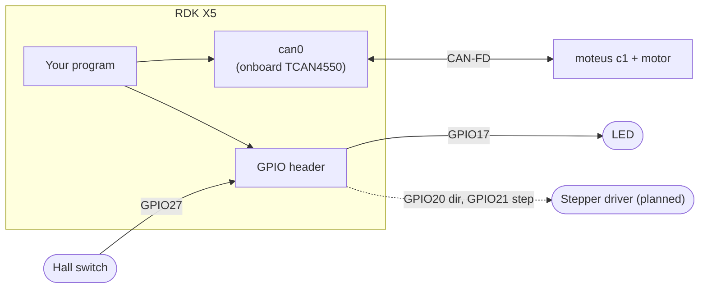
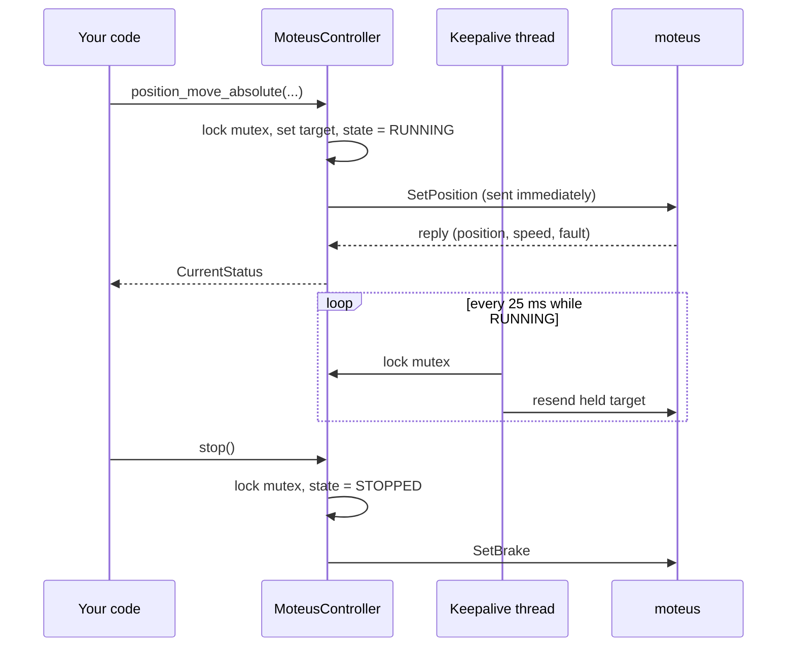
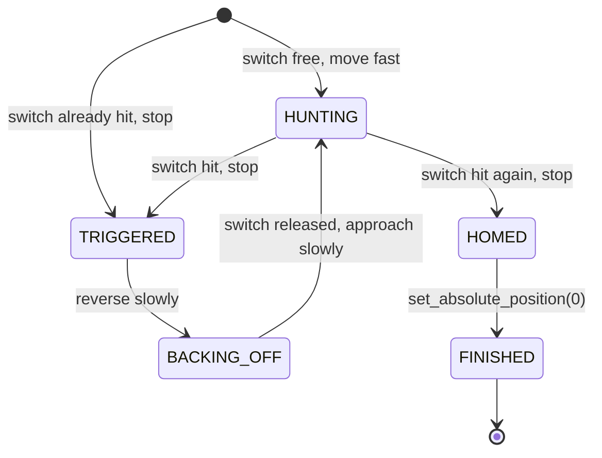
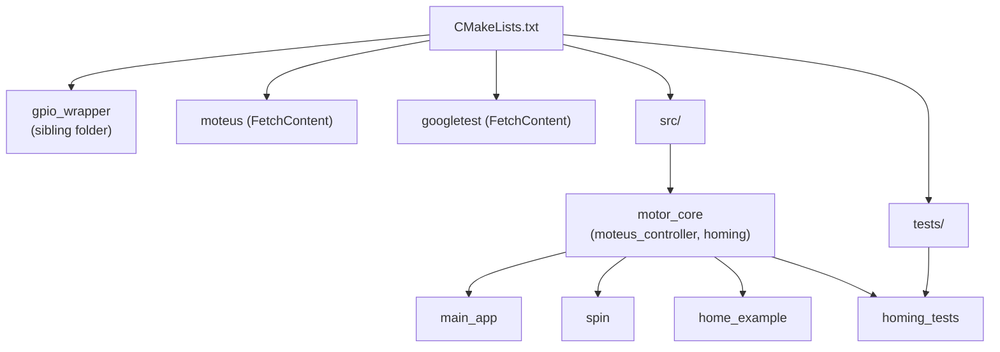
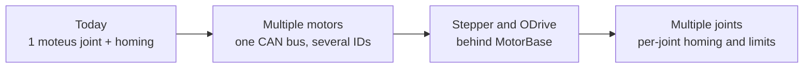

# motor_testing

Test repo for driving motors from an **RDK X5** behind one common `MotorBase` interface. The first implementation drives a **mjbots moteus c1** over the onboard CAN-FD bus. A hall switch on a GPIO pin is used for homing. Stepper and ODrive support are planned behind the same interface.

CMake project name: `moteus_test`

## Status

| Part | State |
|---|---|
| Onboard CAN (`can0`, CAN-FD 1M/5M) talking to the moteus | Working |
| `MotorBase` interface (revolutions, rev/s, rev/s²) | Done |
| `MoteusController` (moves, stop, enable, set zero, keepalive thread) | Working |
| Homing state machine (`Homing`) with unit tests | Working |
| GoogleTest suite and CI (build, test, lint) | Set up |
| `StepperController` (step/dir) | Skeleton, not built yet |
| Multiple motors, ODrive, multiple joints | To do (see Roadmap) |

## Hardware



| Signal | GPIO | Physical pin |
|---|---|---|
| Hall switch (active low) | 27 | 13 |
| LED | 17 | 11 |
| Stepper DIR | 20 | 38 |
| Stepper STEP | 21 | 40 |

## Code layout

```mermaid
classDiagram
    class MotorBase {
        <<abstract>>
        +position_move_absolute(pos, accel, speed)
        +position_move_relative(pos, accel, speed)
        +stop()
        +enable()
        +set_absolute_position(pos)
    }
    class MoteusController {
        +get_position()
        +get_current_status()
        -keepalive thread
    }
    class StepperController {
        <<in progress>>
    }
    class Homing {
        +execute_homing()
        +check_homing_outcome()
    }
    class MockMotor {
        <<tests>>
    }
    MotorBase <|-- MoteusController
    MotorBase <|-- StepperController
    MotorBase <|-- MockMotor
    Homing --> MotorBase : drives
    MoteusController *-- "moteus::Controller"
```

All moves take **revolutions**, **rev/s** for speed and **rev/s²** for acceleration. Every call returns `std::optional<CurrentStatus>` (`position`, `speed`, `status_code`); `nullopt` means the command failed.

| Path | Purpose |
|---|---|
| `include/motor_base.hpp` | `MotorBase` interface and `CurrentStatus` |
| `include/moteus_controller.hpp`, `src/moteus_controller.cpp` | moteus implementation |
| `include/homing.hpp`, `src/homing.cpp` | Motor-agnostic homing state machine |
| `include/stepper_motor_controller.hpp`, `src/stepper_motor_controller.cpp` | Stepper skeleton (not part of `motor_core` yet) |
| `main.cpp` | Demo: sweep the motor while mirroring the hall switch on the LED |
| `src/spin.cpp` | Simple sweep test |
| `src/homing_example.cpp` | Full homing run with an LED thread, then a short move test |
| `tests/` | `MockMotor` and the homing tests |
| `workflows/` | CI definitions (build and test, lint) |

## How MoteusController works

moteus drops into a timeout fault (mode 11) if no command arrives within 100 ms by default. A small keepalive thread prevents that.



- One mutex guards the controller and the held target, so the keepalive can never resend a move after a `stop()`.
- Velocity and acceleration limits are sent with every position command (the constructor enables them in the position format).
- `enable()` reads the current position, holds it, and starts the keepalive.
- `set_absolute_position()` re-zeros the controller and, if running, holds at the new origin.
- `get_position()` does a fresh query, `get_current_status()` returns the cached reply of the last command.

## Homing

`Homing` takes any `MotorBase`, a function that reports whether the switch is hit, and a start direction. Call `execute_homing()` repeatedly (about every 10 ms). The clock is injectable so tests can simulate a timeout.



From any state, 60 s without finishing gives `ERROR_TIMEOUT`. Speeds: fast 4.0 rev/s, slow 1.0 rev/s, acceleration 2.0 rev/s², each search move up to 1.1 rev.

## Build and run



```bash
cmake -S . -B build
cmake --build build
./build/src/spin            # or main_app, home_example
cd build && ctest --output-on-failure   # runs homing_tests
```

Run with the motor **unloaded** and power applied to the c1 (10 to 51 V).

Prerequisites: RDK X5 with `can0`, CMake 3.14+, a C++20 compiler, libgpiod 1.x with C++ bindings (`libgpiod`, `libgpiodcxx`), {fmt}, the `gpio_wrapper` project checked out next to this repo (`../gpio_wrapper`), and network access at configure time (moteus and googletest are fetched).

### Bring up CAN

The settings do not survive a reboot, so re-run after every boot:

```bash
sudo ip link set can0 down
sudo ip link set can0 up type can bitrate 1000000 dbitrate 5000000 \
    sjw 10 dsjw 5 sample-point 0.666 dsample-point 0.666 restart-ms 1000 fd on
ip -details link show can0   # expect: UP, FD, ERROR-ACTIVE, no LOOPBACK
```

The kernel rounds some timing values to what the 20 MHz controller clock can produce (the data-phase sample point becomes 0.5); that is expected. Both ends of the bus need 120 ohm termination.

## Roadmap



- [ ] **Multiple motor control**: several `MoteusController` instances on one bus (unique CAN IDs, shared transport)
- [ ] **ODrive motor control setup**: an `MotorBase` implementation for an ODrive (interface to be decided)
- [ ] **Stepper motor control setup**: finish `StepperController` (step/dir pulse thread, trapezoidal profile) and add it to `motor_core`
- [ ] **Multiple joint setup**: a joint abstraction combining a motor, its home switch and limits, with a homing run per joint

## References

- moteus documentation: https://mjbots.github.io/moteus/
- moteus C++ client: https://mjbots.github.io/moteus/integration/cpp/
- moteus control modes: https://mjbots.github.io/moteus/guides/control-modes
- moteus on socketcan: https://mjbots.github.io/moteus/platforms/socketcan/
- RDK X5 CAN guide: https://developer.d-robotics.cc/rdk_x_doc/en/Advanced_development/hardware_development/rdk_x5/can?v=3.5.0&p=RDK+X5
