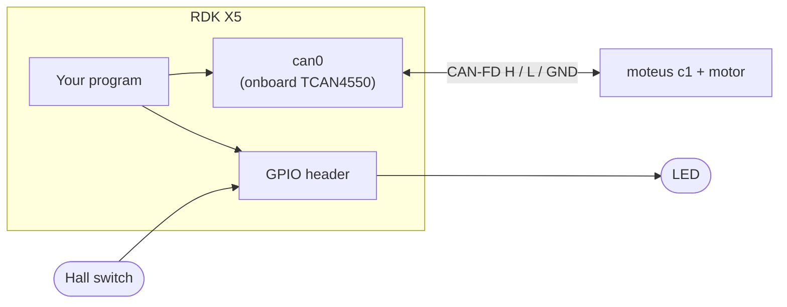
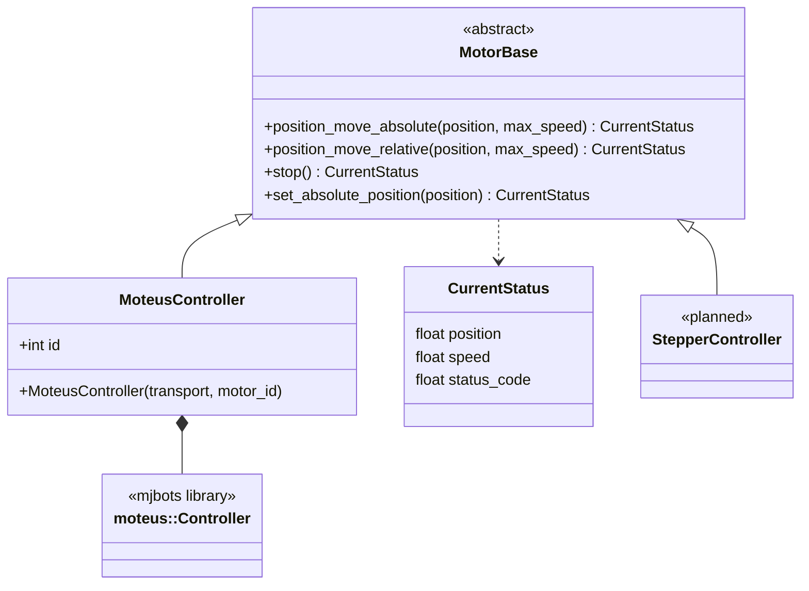
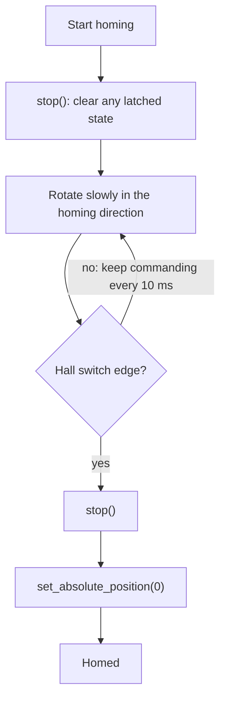

# motor_testing

Test repo for driving motors from an **RDK X5** behind one common `MotorBase` interface. The first implementation targets a **mjbots moteus c1** brushless controller over the onboard CAN-FD bus. Other motors, such as stepper motors, are meant to plug in behind the same interface. A hall switch on a GPIO pin is used for homing.

CMake project name: `moteus_test`

## Status

| Part | State |
|---|---|
| Onboard CAN (`can0`, CAN-FD 1M/5M) talking to the moteus | Working |
| `spin`: query start position, then sweep back and forth | Working |
| `MotorBase` interface | Defined |
| `MoteusController` (implements `MotorBase`) | Stubs only: methods return an empty `CurrentStatus` |
| Hall-switch homing / LED on edge events (`main`) | In progress |
| Homing routine | To do |
| Stepper motor support | Planned |

## Hardware



## Code layout



| File | Purpose |
|---|---|
| `CMakeLists.txt` | Builds `main` and `spin`; fetches moteus; links the sibling `gpio_wrapper` library |
| `src/spin.cpp` | Standalone test: reads the starting position, sends a stop, then sweeps the target position by +/-1.0 revolutions in 0.001 rev steps every 10 ms and prints mode, fault, position and velocity |
| `main.cpp` | Combined program (motor + GPIO events); in progress |
| `include/motor_base.hpp` | `MotorBase` abstract interface and `CurrentStatus` struct |
| `include/moteus_controller.hpp`, `src/moteus_controller.cpp` | `MoteusController`: moteus implementation of `MotorBase` (shares one CAN transport between motors) |

Planned `MotorBase` behavior: absolute and relative moves with speed in **deg/s**, stop, and "set current position as zero". Note that moteus itself works in **revolutions** and revolutions per second, so the controller class will need to convert.

## Homing routine (to do)

Goal: rotate the motor until the hall switch triggers, then define that point as position zero. The routine should live behind `MotorBase`, using the planned `set_absolute_position()`, so it works for any motor type.



Open decisions:

- Homing direction and speed
- Which edge defines zero (entering or leaving the magnet's range) and the switch's active level
- Behavior if no edge is found (maximum travel or timeout, then stop and report a fault)
- How hall events reach the control loop (the `gpio_wrapper` event results are not publicly readable yet)

## Prerequisites

- RDK X5 with `can0` available
- CMake 3.14+, a C++20 compiler
- libgpiod 1.x with C++ bindings (`libgpiod`, `libgpiodcxx`)
- {fmt}
- The `gpio_wrapper` project checked out next to this repo (`../gpio_wrapper`)
- Network access at configure time (the moteus C++ library is fetched with `FetchContent` at the commit pinned in `CMakeLists.txt`)

## Bring up CAN

The settings do not survive a reboot, so re-run after every boot:

```bash
sudo ip link set can0 down
sudo ip link set can0 up type can bitrate 1000000 dbitrate 5000000 \
    sjw 10 dsjw 5 sample-point 0.666 dsample-point 0.666 restart-ms 1000 fd on
ip -details link show can0   # expect: UP, FD, ERROR-ACTIVE, no LOOPBACK
```

The kernel rounds some timing values to what the 20 MHz controller clock can produce (for example the data-phase sample point becomes 0.5); that is expected. Both ends of the bus need 120 ohm termination.

## Build and run

```bash
cmake -S . -B build
cmake --build build                 # all targets
cmake --build build --target spin   # just spin
./build/spin
```

Run with the motor **unloaded** and power applied to the c1 (10 to 51 V).

## Notes

- moteus enters a timeout mode (mode 11) if it does not receive a command at least every 100 ms by default. A stop command clears it, so `spin` sends one before starting its loop.
- Position is reported in revolutions.

## Roadmap

- [ ] Implement the `MoteusController` methods (absolute move, relative move, stop, set zero) with deg/s to rev/s conversion
- [ ] Fill in `CurrentStatus` from the moteus reply
- [ ] Homing routine (see above) using `gpio_wrapper` hall-switch events
- [ ] LED on at the first edge and off at the leaving edge
- [ ] Clean shutdown on Ctrl+C (send stop before exiting)
- [ ] Add a stepper motor implementation of `MotorBase` (planned; control interface to be decided)

## References

- moteus documentation: https://mjbots.github.io/moteus/
- moteus C++ client: https://mjbots.github.io/moteus/integration/cpp/
- moteus on socketcan: https://mjbots.github.io/moteus/platforms/socketcan/
- RDK X5 CAN guide: https://developer.d-robotics.cc/rdk_x_doc/en/Advanced_development/hardware_development/rdk_x5/can?v=3.5.0&p=RDK+X5
